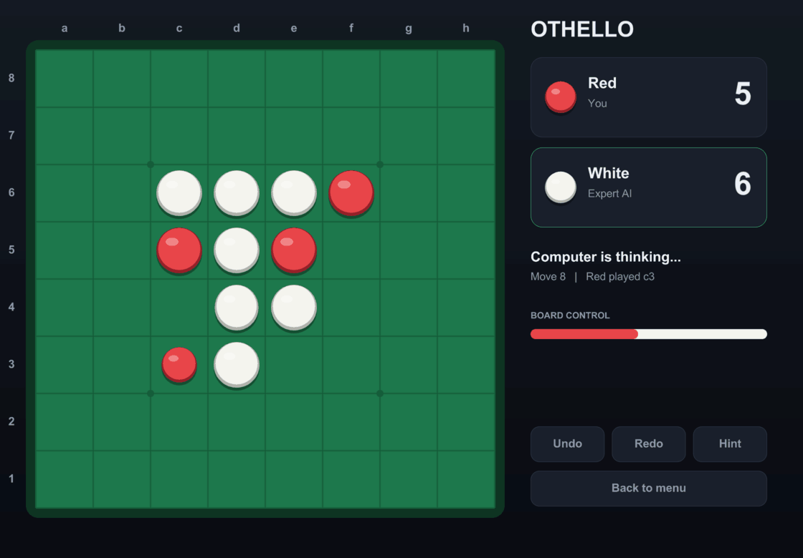
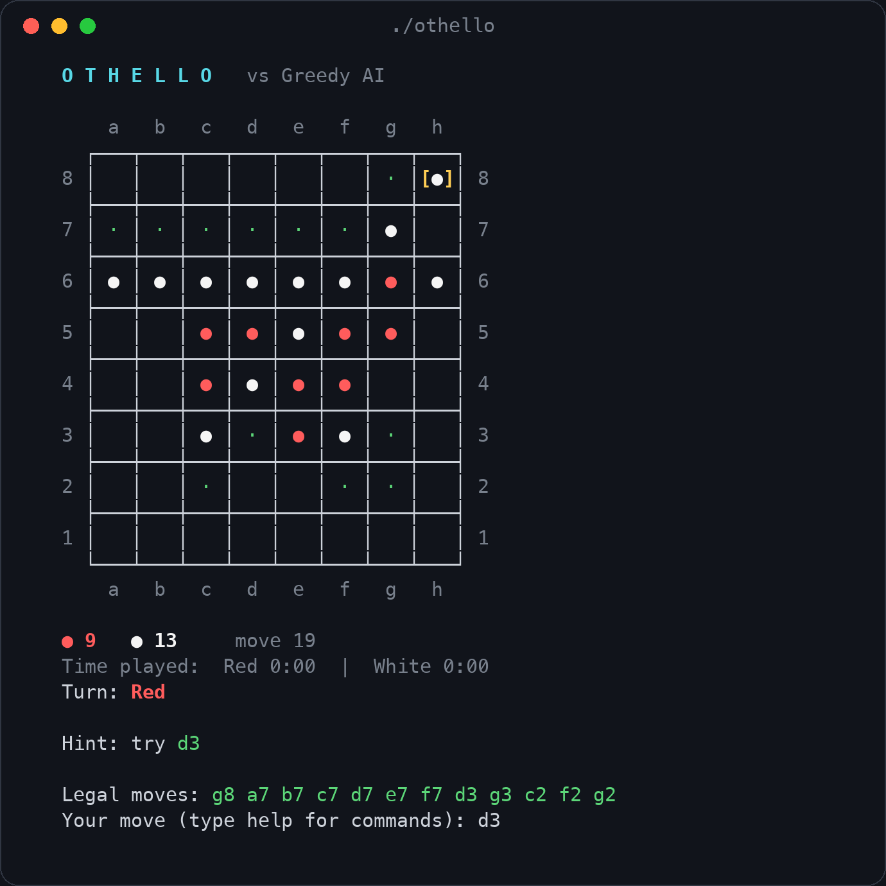
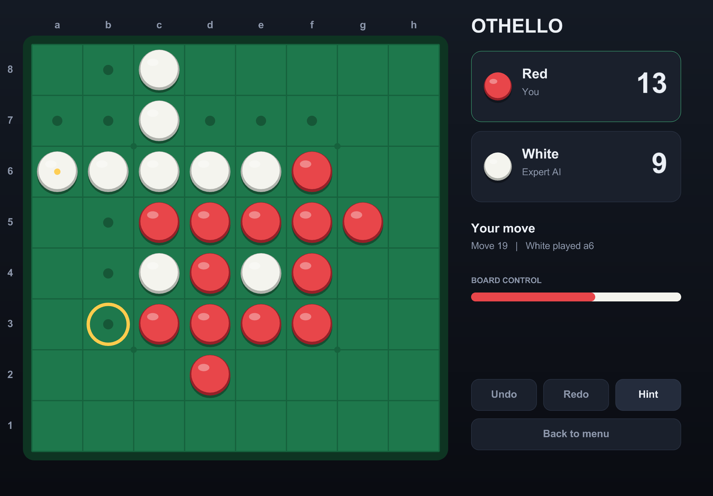
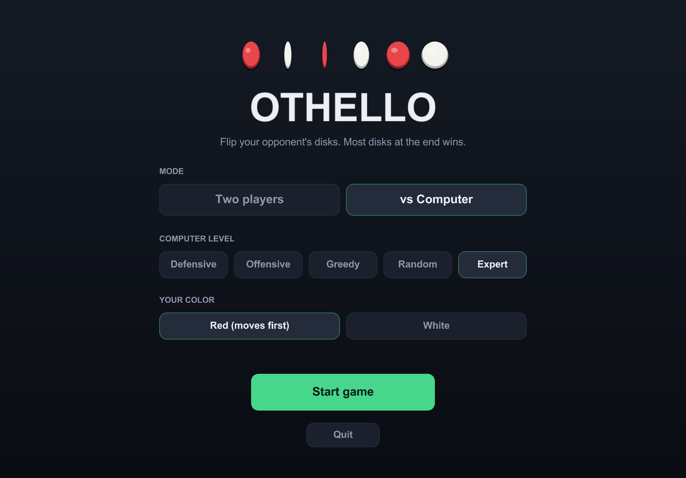
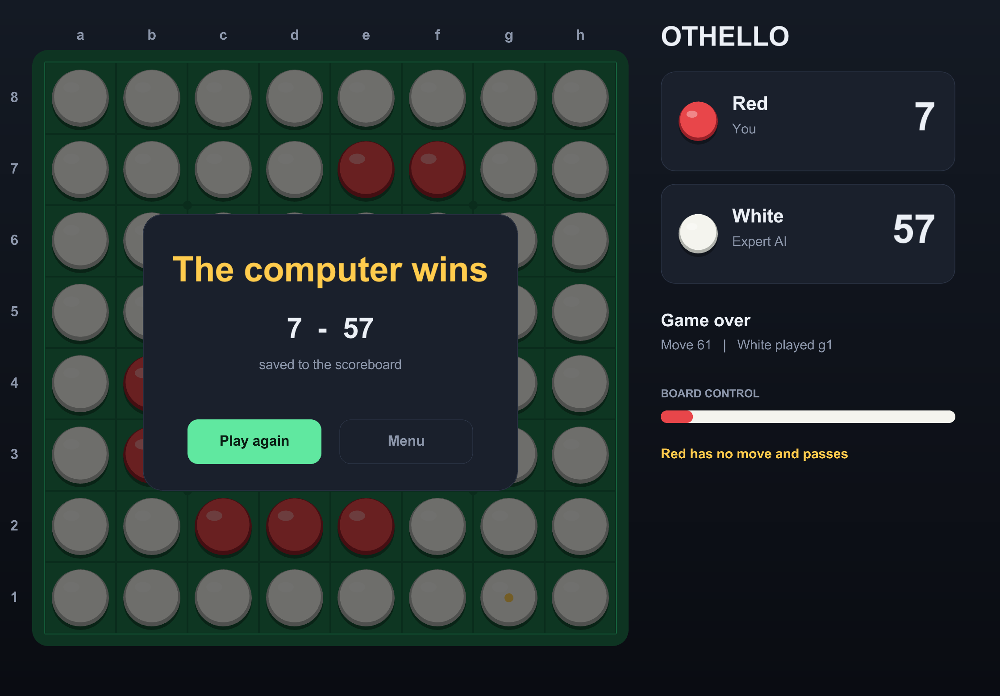

# Othello

Othello (Reversi) in C++, playable in the terminal or in a window, with five computer opponents from "a bit dumb" to "please stop".



## About

This was my **final project for the Basic Programming course** at the **University of Guilan** (Fall 2025, Sep 2025 – Feb 2026). It was my first real program bigger than a homework exercise: everything is plain C++ with arrays, structs and functions, no classes, which was the point of the course.

## Features

- Two players on one computer, with an optional 5 minute clock for each side
- Play against the computer, five levels:
  - **Defensive**: picks the move that leaves the opponent the weakest reply
  - **Offensive**: likes corners and edges, avoids handing out corners
  - **Greedy**: mixes mobility, position, disk count and corner safety
  - **Random**: exactly what it sounds like
  - **Expert**: minimax search 5 moves deep with alpha-beta pruning
- Undo and redo (against the computer it undoes your move and its reply together)
- Hints from the Expert AI
- Save and load games, including the full undo history
- Scoreboard with every finished game
- Puzzle mode: a random mid-game position, find the best move
- Window version with animated disk flips, hover previews and the same AI levels

## How the Expert AI works

The other AIs only look at the move they are about to play. The Expert looks 5 plies ahead with **minimax**: it assumes the opponent will always answer with the move that is worst for it, and picks the move whose worst case is best.

To keep that fast it uses **alpha-beta pruning**, which stops exploring a branch as soon as it is clear the branch can't change the decision. It also tries corner-like moves first, because good moves found early let it prune much more.

A position is scored with:

- a weight table for every square (corners are gold, the squares next to corners are dangerous)
- mobility, how many moves each side has
- disk count, but only near the end of the game, since having more disks early on is usually a bad sign

In my tests it won 20 out of 20 games against the Random AI and beats the Greedy AI from both sides.

## Getting started

You need a C++17 compiler and `make`.

**Terminal version** (no extra libraries):

```bash
make
./othello
```

**Window version** needs [raylib](https://www.raylib.com/):

```bash
brew install raylib    # macOS, on Linux use your package manager or build raylib from source
make othello-gui
./othello-gui
```

## How to play

In the terminal, type a square like `d3` to place a disk. Other commands:

| Command | What it does |
| --- | --- |
| `hint` | asks the Expert AI for a move |
| `undo` / `redo` | steps through the move history |
| `save` | saves the game under a name |
| `quit` | back to the main menu |
| `help` | shows these commands |

Green dots on the board are your legal moves, and the last move is shown in yellow brackets.

In the window version, just click a square. Undo, redo and hint are buttons on the right.

## Project structure

```
src/
  board.h/.cpp      board, legal moves, flipping disks
  ai.h/.cpp         the five AI strategies, including minimax
  game.h/.cpp       game state, undo/redo history, the terminal game loop
  display.h/.cpp    drawing the board in the terminal, reading input
  storage.h/.cpp    save/load and the scoreboard
  puzzle.h/.cpp     puzzle mode
  main.cpp          terminal menus
  gui/
    app.h/.cpp      window version: menu and game logic
    draw.h/.cpp     window version: everything that gets drawn
    main.cpp        window version: the raylib loop
```

The window version doesn't have its own copy of the rules. It uses `board`, `ai`, `game` and `storage` exactly like the terminal version does, and only adds input and drawing on top.

## Screenshots

| Terminal | Window |
| --- | --- |
|  |  |

| Menu | Game over |
| --- | --- |
|  |  |

## License

[MIT](LICENSE)
